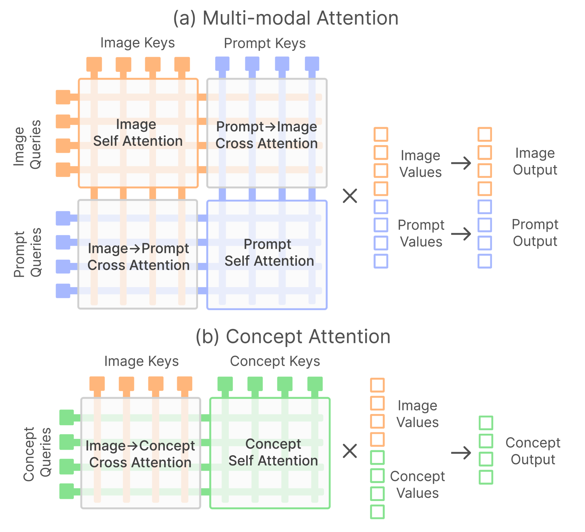
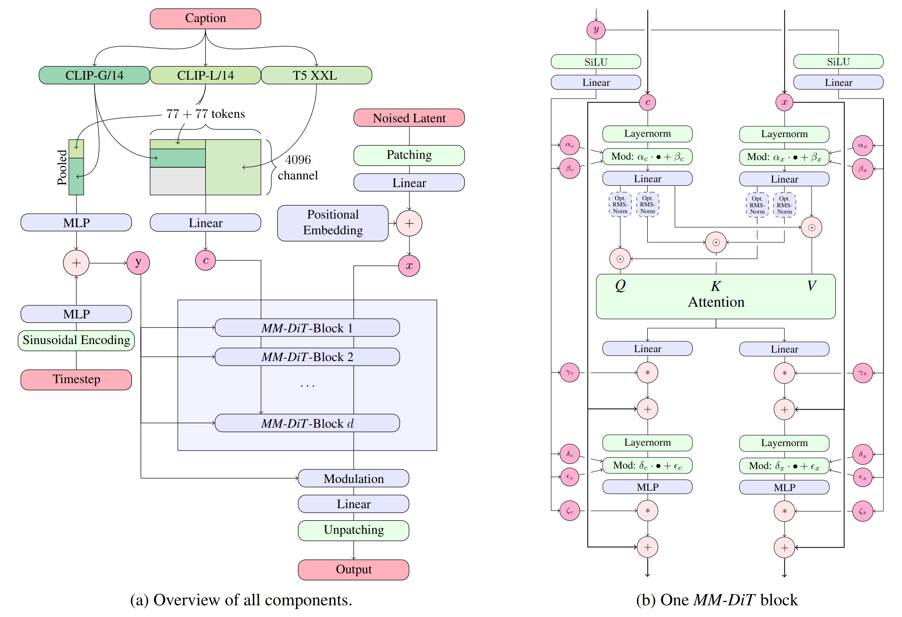
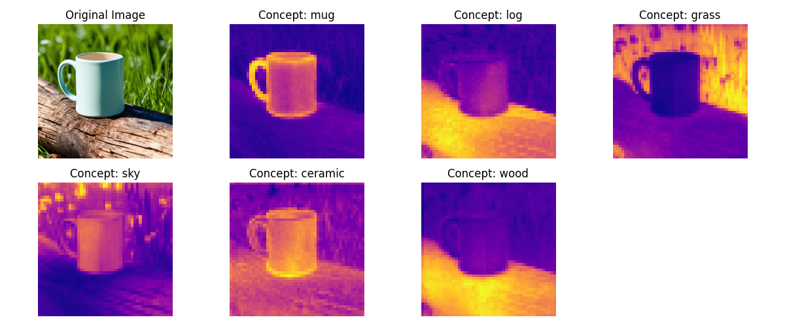
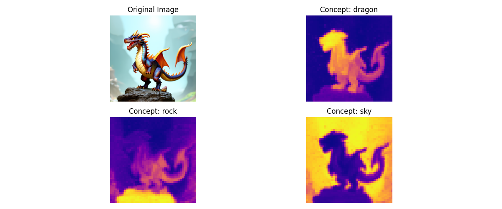
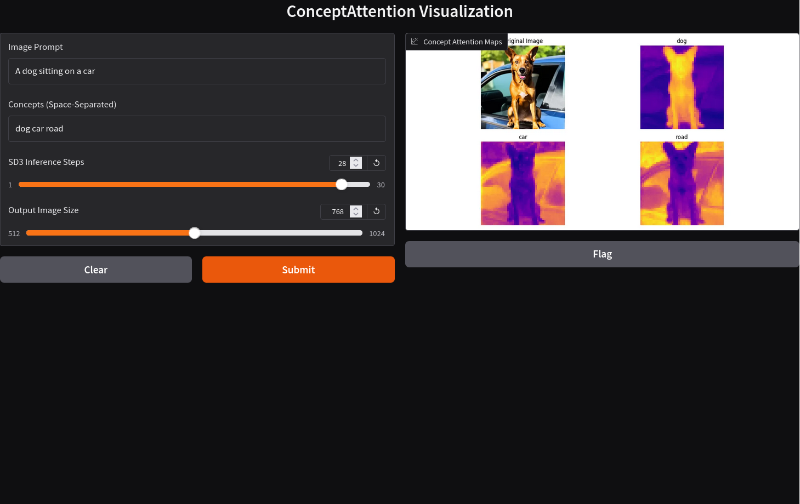

# Stable Diffusion 3: Concept Attention

This is an implementation of Concept Attention introduced in [this paper](https://arxiv.org/abs/2502.04320).

Due to compute limitations, we use stable-duffison 3-medium as the base Diffusion- transformer model without T5 encoder as it's too heavy to run for me.

This paper proposes a method to test interpretability by generate saliency maps that locate the concepts provided in the image generate (or provided as input). This method does not require any additional training, we just modify the MMATTN mechanism to perform a custom cross attention between the concept embeddings and image embeddings in a separate channel without changing the standard MMAttn.

### Attention Mechanism in MM-DiT:
As shown in the paper:

  

---

## Method & Pipeline

1. First we load the SD3 pipeline from the [diffusers library](https://huggingface.co/docs/diffusers/api/pipelines/stable_diffusion/stable_diffusion_3)
2. then generate embeddings for the concepts using CLIP-G and CLIP-L encoders as shown in the stable diffusion 3 paper:

  

3. Then by inspecting transformer block's attention model, we modify the `attn.processor` block with a custom implementation where concept embeddings attend to the image embeddings in cross attention and image does not attend to concepts.
   * This ensures the image isn't modified based on concepts.
   * The conecepts query is generated based on the same weights as text prompt.

---

## Mathematical Formulation

$$K_{xc} = [K_{x}^{1}, \ldots, K_{x}^{n}, K_{c}^{1}, \ldots, K_{c}^{r}] \tag{5}$$

$$V_{xc} = [V_{x}^{1}, \ldots, V_{x}^{n}, V_{c}^{1}, \ldots, V_{c}^{r}] \tag{6}$$

$$O_c = \text{softmax}\left(Q_c K_{xc}^\top\right) V_{xc} \tag{7}$$

* We then modify the transformer block to unpack concept embedding outputs.
* Finally, we replace the attention's processor and transformer block's forward method through monkey patching.
* Then, performing dot-product similarity between image output and concept output, we generate saliency heatmaps.

Any concept not present in the image, saliency map of closest semantic meaning will be generated.

---

## Saliency Heatmap Results

Here's the results:

  
   
  

---

## Web UI & Demo

There's also a simple gradio web UI in [gradio_ui.py](./gradio_ui.py), hosted in hugginface spaces, but no GPU :(

-> [hf space](https://huggingface.co/spaces/AxleToe/Concept_Attn_SD3)

  

