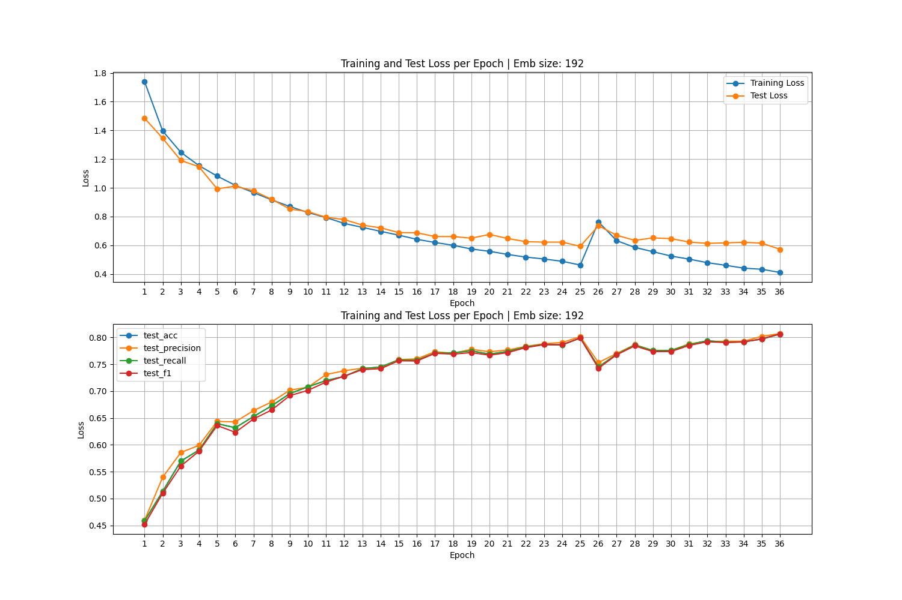
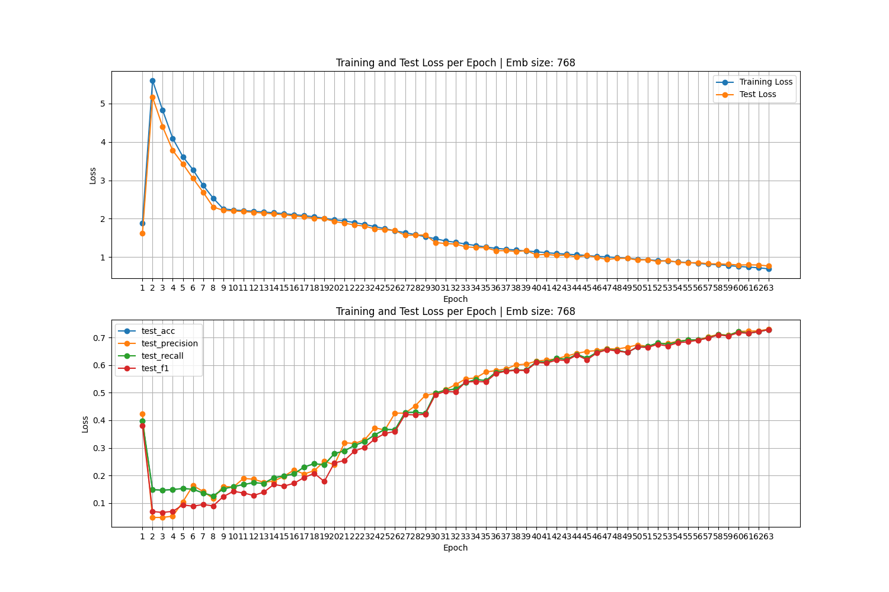
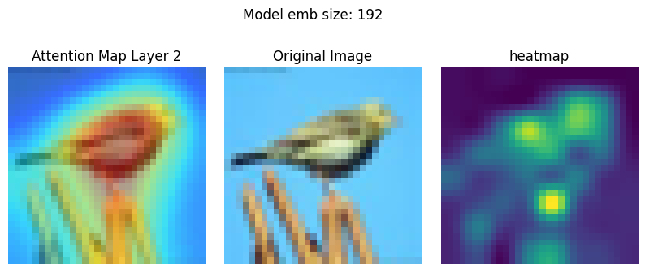
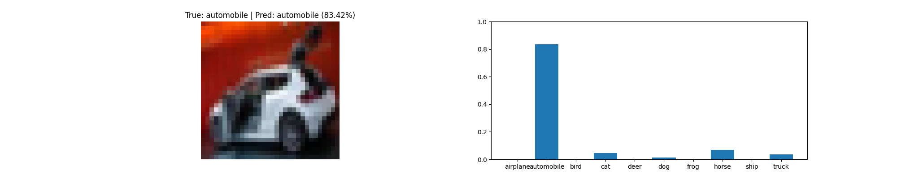
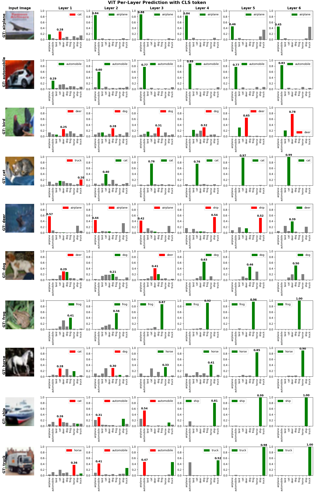

# Vision Transformer (ViT) on CIFAR10

This is an implementation of Vision Transformer model in PyTorch, trained on [CIFAR10](https://cave.cs.toronto.edu/kriz/cifar.html) dataset from scratch.

The implementation mostly follows the details from [ViT paper](https://arxiv.org/abs/2010.11929).

### Training Details & Hyperparams
* AdamW optimizer
* **Hyperparams:**
  * `patch_size = 4` instead of usual 16x16 as the image size is too small(32).
  * `depth = 6`
  * `heads per layer = 3`

---

## Ablative Studies

Two different checkpoints for embedding size 192 and 768 were saved. Checkpoints are saved at best test loss.

### Simple ablative studies:

<p align="center">
  
  
</p>

---

## Attention Rollout Implementation

The trained model is put to eval and ran for inference on a random image from test data.

Avg Attention weights across all heads per layer was obtained by the returned outputs of [PyTorch's MHA](https://docs.pytorch.org/docs/main/generated/torch.nn.modules.activation.MultiheadAttention.html#:~:text=attn%5Foutput%5Fweights%20%2D%20Only,L%2CS%29)

So we obtain a list of attention weights of:
```python
shape = num_heads * (N, L, S) # N -> batch size, L -> target seq len, S -> source seq len
```

each layer attn weights are recursively run through the following eq:

Here's the rollout equation in LaTeX, matching what your code computes:

#### Per-layer step:

$$
\hat{A}^{(l)} = \frac{A^{(l)} + I}{\text{rowsum}(A^{(l)} + I)}
$$

#### Recursive rollout:

$$
\tilde{A}^{(l)} = \hat{A}^{(l)} \cdot \tilde{A}^{(l-1)}, \qquad \tilde{A}^{(0)} = \hat{A}^{(0)}
$$

---

## Heatmap & Superimposition

We only require the attention map from the CLS addition token added in ViT model as it contains details about rest of image through self attention.

```python
so cls attn map= [0,0, 1:]
```

this is because we take ->first batch -> cls query row (what cls attends TO) -> ignore cls token and get rest of img attn

we get cls of size 8x8 (num of patches), so we resize image to produce heatmap of original image size = 32x32
then we superimpose heatmap on image to clearly show attention map of the model for the image.

### Visualizations

here is the result for one image:

<p align="center">
  
</p>

#### output probs:

<p align="center">
  
</p>

Also did an interesting experiment to show the layer wise predictions using the CLS token on every layer to see how the model arrives at correct predction...

<p align="center">
  
</p>
